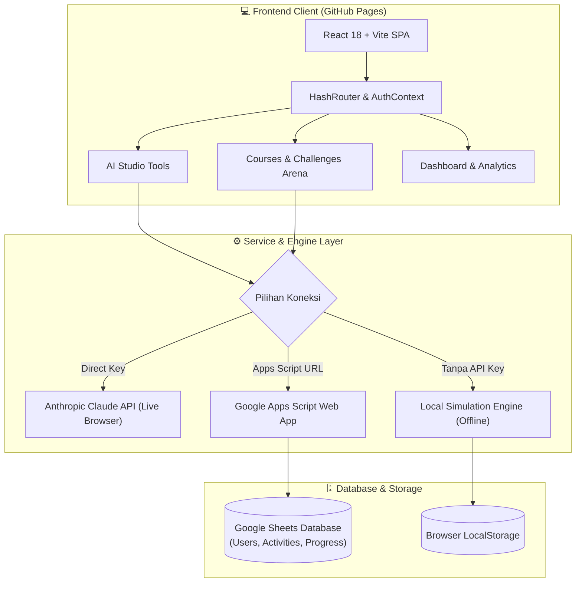

<div align="center">

# ⚡ TOOLS WEB
### Next-Gen AI Developer Studio & Interactive Coding Academy

[](https://react.dev/)
[](https://vitejs.dev/)
[](https://tailwindcss.com/)
[](https://www.anthropic.com/)
[](LICENSE)
[](https://RakhaZuhdiNaufal.github.io/Membuat-Tools-Web/)

<br />

**Platform all-in-one bagi software engineer untuk merancang, menguji, dan mengubah kode dengan AI tercanggih, sekaligus mengasah kemampuan pemrograman melalui tantangan interaktif yang dievaluasi secara otomatis.**

[🌐 Kunjungi Website](https://RakhaZuhdiNaufal.github.io/Membuat-Tools-Web/) • [🚀 Coba Akun Demo](#-akun-demo-pengujian-cepat) • [🛠️ Fitur & Tools](#-fitur-utama) • [⚙️ Panduan Setup](#-panduan-instalasi--setup-lokal) • [📖 Dokumentasi API](#-setup-backend-google-apps-script)

</div>

---

## 🌟 Mengapa Tools Web?

Tools Web bukan sekadar code generator biasa. Platform ini dibangun khusus untuk menjembatani ide ke implementasi kode nyata (*from concept to production-ready code*):

- 🎯 **Arsitektur Dual Engine**: Mendukung koneksi live **Anthropic Claude API** (langsung dari browser atau via serverless Google Apps Script) sekaligus dilengkapi **Offline Simulation Engine** agar seluruh fitur tetap dapat dicoba kapan saja.
- ⚡ **Zero-Cost Infrastructure**: Berjalan 100% di atas hosting gratis **GitHub Pages** dan database serverless **Google Sheets**.
- 🧪 **Interactive Learning with Auto-Grading**: Pembelajaran interaktif fundamental web (HTML, CSS, JavaScript) dengan sistem *grading* dan saran evaluasi instan dari Claude AI.
- 🎨 **Developer-First Design System**: Antarmuka terinspirasi dari IDE modern dengan palet warna *Dark Emerald Green* & *Clean Light Mode*.

---

## 🚀 Fitur Utama

### 1. 🧰 AI Developer Studio (6 Specialized Tools)

| Tool | Fungsi Utama | Output & Kemampuan |
| :--- | :--- | :--- |
| **💬 AI Prompt Chat & Assistant** | Konsultasi arsitektur, prompt engineering & logic brainstorming | Analisis kebutuhan, saran best practice, serta Master Prompt markdown siap pakai tanpa spam emoji. |
| **⚡ React & Tailwind Live Sandbox** | Generator antarmuka web, dashboard CRUD, & interactive mini-game | Menghasilkan kode JSX + Tailwind dengan **Live Preview Sandbox** interaktif seketika di layar. |
| **📱 React Native Mobile Studio** | Arsitektur aplikasi mobile berbasis React Native & Expo | Komponen mobile modular lengkap dengan SafeAreaView, ScrollView, FlatList, & simulasi smartphone. |
| **🔄 React to PHP REST API Studio** | Transformasi kode frontend React menjadi Backend REST API PHP | Menghasilkan file `api.php` aman (CORS, validasi input, prepared PDO, JSON response) + helper fetch React. |
| **🎨 AI Image Generator** | Pembuat aset visual, banner UI, dan mockup grafis digital | Generator gambar resolusi tinggi dengan berbagai pilihan preset style artistik dan tech aesthetic. |
| **🎬 AI Video & Motion Director** | Perancang storyboard sinematik dan motion graphic coding | Rencana storyboard multi-scene, camera direction, serta export prompt untuk AI video engine (Sora, Runway, Luma). |

---

### 2. 🎓 Interactive Courses & AI Coding Challenges

Platform menyediakan kurikulum terstruktur untuk menguasai fondasi web development:

```
📚 INTERACTIVE CURRICULUM
 ├── 🌐 HTML Fundamentals (5 Modul + 3 Coding Challenges)
 │    ├── Elemen Struktur & Semantik
 │    ├── Link, Gambar, & Multimedia
 │    └── Form Interaktif & Input Validasi
 ├── 🎨 CSS Fundamentals (5 Modul + 3 Coding Challenges)
 │    ├── Selektor, Box Model, & Warna
 │    ├── Flexbox Layout Mastery
 │    └── Responsive Web Design & Media Queries
 └── ⚡ JavaScript Fundamentals (5 Modul + 3 Coding Challenges)
      ├── Variabel, Tipe Data, & Operator
      ├── Functions, Scope, & Array Methods
      └── DOM Manipulation & Event Handling
```

> 🤖 **AI Evaluator**: Setiap kode jawaban yang Anda submit pada tantangan coding akan dibedah oleh AI secara otomatis: status kelulusan (*Passed / Needs Improvement*), skor numerik (0–100), ulasan perbaikan, dan contoh solusi optimal.

---

### 3. 📊 Informative SaaS Dashboard & User Management
- **Dashboard Metrik Real-Time**: Ringkasan *Total AI Requests*, *Tools Used*, *Courses Completed*, dan *Learning Progress*.
- **Recent Activities Log**: Riwayat eksekusi AI tools secara transparan.
- **Autentikasi Aman**: Registrasi, Login berbasis Session Token, password di-hash dengan **SHA-256 + Salt**.
- **1-Click Demo Login**: Masuk instan tanpa perlu registrasi untuk tujuan review dan evaluasi.
- **Theme Switcher**: Pilihan tema **Light Mode** & **Dark Green Emerald Mode** dengan persistensi otomatis di `localStorage`.

---

## 🏗️ Arsitektur Sistem



---

## 🛠️ Technology Stack

<div align="center">

| Kategori | Teknologi | Deskripsi |
| :--- | :--- | :--- |
| **Frontend Framework** | **React 18 + Vite 6** | Arsitektur SPA berperforma tinggi dengan HMR instan |
| **Styling & Icons** | **Tailwind CSS 3 + Lucide React** | Utility-first CSS dengan custom Emerald Design System |
| **Routing** | **React Router DOM 6** | Menggunakan `HashRouter` untuk kompatibilitas mutlak GitHub Pages |
| **Syntax Highlighting** | **Prism.js** | Pewarnaan sintaksis kode multi-bahasa yang tajam |
| **AI Intelligence** | **Anthropic Claude 3.5 Sonnet** | Model AI penalaran tingkat tinggi untuk coding & evaluasi |
| **Serverless Backend** | **Google Apps Script** | Web App serverless tanpa biaya server |
| **Database** | **Google Sheets API** | Basis data multi-sheet terstruktur |
| **CI / CD Pipeline** | **GitHub Actions** | Build otomatis dan deployment ke GitHub Pages saat push ke branch `main` |

</div>

---

## 💻 Panduan Instalasi & Setup Lokal

### Prasyarat
- [Node.js](https://nodejs.org/) versi 18 atau lebih baru.
- [Git](https://git-scm.com/) terpasang di komputer Anda.

### 1. Clone Repository
```bash
git clone https://github.com/RakhaZuhdiNaufal/Membuat-Tools-Web.git
cd Membuat-Tools-Web
```

### 2. Install Dependencies
```bash
npm install
```

### 3. Konfigurasi Environment (Opsional)
Salin template environment:
```bash
cp .env.example .env
```
Isi konfigurasi (jika ingin menghubungkan ke Google Apps Script atau menentukan model Claude):
```env
VITE_APPS_SCRIPT_URL=
VITE_ANTHROPIC_MODEL=claude-3-5-sonnet-20241022
```

### 4. Jalankan Development Server
```bash
npm run dev
```
Buka browser di `http://localhost:5173` untuk melihat aplikasi.

---

## ⚙️ Setup Backend (Google Apps Script & Database)

Jika Anda ingin mengaktifkan backend cloud menggunakan Google Sheets & Google Apps Script:

### 1. Buat Google Spreadsheet
1. Buka [Google Sheets](https://sheets.new).
2. Beri nama spreadsheet Anda, misalnya **`Tools Web Database`**.

### 2. Pasang Kode Apps Script
1. Di dalam spreadsheet, buka menu **Extensions > Apps Script**.
2. Hapus semua kode default di editor.
3. Salin seluruh isi file [`apps-script/code.gs`](apps-script/code.gs) pada repo ini dan tempelkan ke editor.
4. Simpan dengan menekan `Ctrl + S`.

### 3. Konfigurasi API Key Anthropic
1. Di panel kiri Apps Script, klik **Project Settings** (ikon gerigi).
2. Pada bagian **Script Properties**, klik **Add script property**:
   - **Property**: `ANTHROPIC_API_KEY`
   - **Value**: `sk-ant-api03-...` (API key Anda dari [console.anthropic.com](https://console.anthropic.com/))
3. Simpan properti.

### 4. Deploy sebagai Web App
1. Klik tombol **Deploy > New deployment** di pojok kanan atas.
2. Pilih jenis deployment: **Web app**.
3. Atur konfigurasi:
   - **Execute as**: `Me (email Anda)`
   - **Who has access**: `Anyone` *(Wajib agar frontend dapat mengakses)*
4. Klik **Deploy** dan berikan otorisasi akun Google.
5. Salin **Web app URL** yang dihasilkan.
6. Masukkan URL tersebut di menu **Settings** pada website Tools Web, atau simpan di file `.env`.

---

## 🌐 Deployment ke GitHub Pages

Project ini sudah dilengkapi workflow otomatis GitHub Actions di [`.github/workflows/deploy.yml`](.github/workflows/deploy.yml).

1. Buka repository Anda di GitHub: **[RakhaZuhdiNaufal/Membuat-Tools-Web](https://github.com/RakhaZuhdiNaufal/Membuat-Tools-Web)**.
2. Buka tab **Settings > Pages**.
3. Di bagian **Build and deployment > Source**, pilih **GitHub Actions**.
4. Setiap kali Anda melakukan `git push` ke branch `main`, GitHub Actions akan otomatis mem-build dan mempublikasikan situs ke:
   ```
   https://RakhaZuhdiNaufal.github.io/Membuat-Tools-Web/
   ```

---

## 🧪 Akun Demo Pengujian Cepat

Ingin mencoba seluruh fitur tanpa registrasi manual? Gunakan akun demo berikut:

| Kredensial | Nilai |
| :--- | :--- |
| **Email** | `developer@toolsweb.dev` |
| **Password** | `password` |
| **Quick Action** | Klik tombol **"Gunakan Akun Demo (1-Click Login)"** di halaman Login |

---

## 📂 Struktur Direktori

```text
Membuat-Tools-Web/
├── .github/
│   └── workflows/
│       └── deploy.yml          # GitHub Actions CI/CD Pipeline
├── apps-script/
│   └── code.gs                 # Serverless Backend Google Apps Script
├── public/                     # Static public assets
├── src/
│   ├── components/             # Reusable UI Components
│   │   ├── CodeEditor.jsx      # Syntax viewer & code editor
│   │   ├── LoadingState.jsx    # Skeleton & loading spinners
│   │   ├── Navbar.jsx          # Top navigation & quick notifications
│   │   ├── Sidebar.jsx         # Collapsible desktop & mobile sidebar
│   │   ├── StatCard.jsx        # Dashboard metric counters
│   │   └── ToolCard.jsx        # AI tool launcher cards
│   ├── context/
│   │   ├── AuthContext.jsx     # Authentication state & session tokens
│   │   └── ThemeContext.jsx    # Dark Emerald & Light mode manager
│   ├── layouts/
│   │   └── DashboardLayout.jsx # Protected layout with route guarding
│   ├── pages/                  # Page Views
│   │   ├── CourseDetail.jsx    # Module lesson reader & challenge editor
│   │   ├── Courses.jsx         # Interactive curriculum catalog
│   │   ├── Dashboard.jsx       # Analytics, metrics, & activity feed
│   │   ├── Login.jsx           # Sign in & 1-click demo access
│   │   ├── Profile.jsx         # User profile & credentials manager
│   │   ├── Register.jsx        # Account registration
│   │   ├── Settings.jsx        # Anthropic key & Apps Script connection
│   │   ├── Tools.jsx           # AI Studio Tools catalog
│   │   ├── Tutorials.jsx       # Developer guides & prompt tips
│   │   └── tools/              # 6 AI Specialized Tool Studios
│   │       ├── ChatPromptTool.jsx     # AI Prompt & Coding Assistant
│   │       ├── CodePreviewTool.jsx    # React & Tailwind Live Sandbox
│   │       ├── ImageGeneratorTool.jsx # AI Graphic & Image Generator
│   │       ├── PhpConverterTool.jsx   # React to PHP REST API Studio
│   │       ├── ReactNativeTool.jsx    # React Native Mobile Architecture
│   │       └── VideoGeneratorTool.jsx # AI Video & Motion Storyboard
│   ├── services/
│   │   ├── api.js              # Anthropic direct caller & fallback engine
│   │   └── mockData.js         # Curriculums, tutorials, and seed data
│   ├── App.jsx                 # HashRouter setup & application routes
│   ├── index.css               # Tailwind directives & design tokens
│   └── main.jsx                # React DOM entry point
├── .env.example                # Template environment variables
├── index.html                  # HTML entry point
├── LICENSE                     # Apache 2.0 License
├── package.json                # Project dependencies and scripts
├── tailwind.config.js          # Tailwind styling configuration
└── vite.config.js              # Vite bundling configuration
```

---

## 📄 Lisensi

Didistribusikan di bawah lisensi **Apache License 2.0**. Lihat file [`LICENSE`](LICENSE) untuk informasi selengkapnya.

<div align="center">
  <sub>Dibangun dengan ❤️ oleh <a href="https://github.com/RakhaZuhdiNaufal">Rakha Zuhdi Naufal</a> menggunakan React & Anthropic Claude.</sub>
</div>
